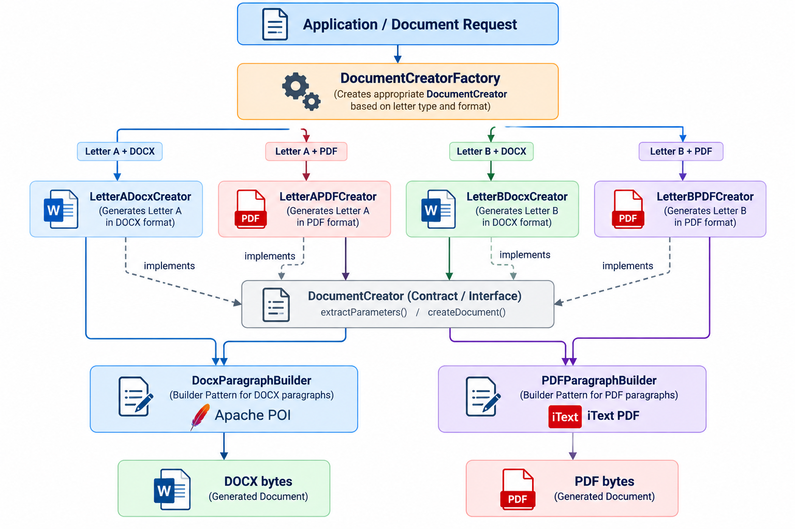
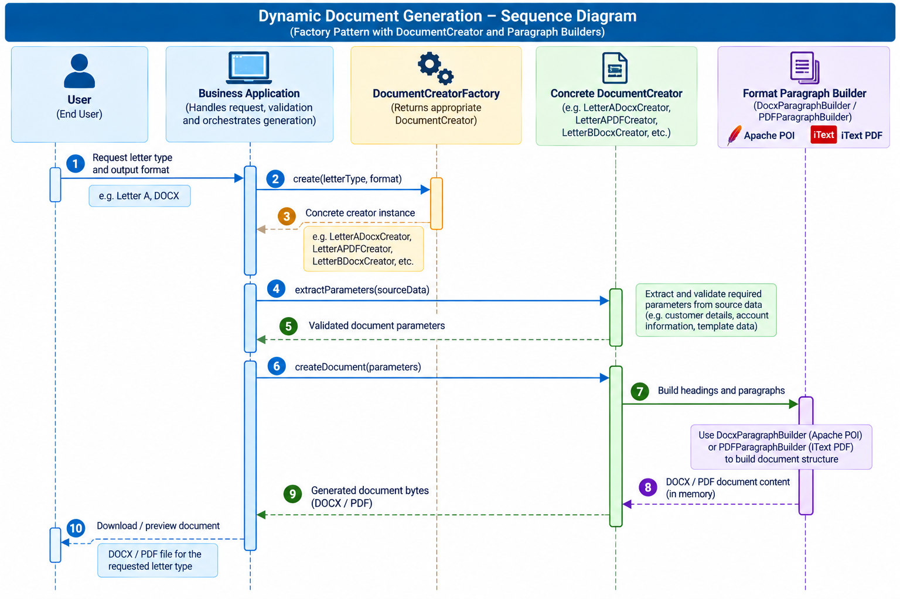

[← Back to engineering portfolio](../../README.md) · [Professional engineering profile](../../01-professional-profile/engineering-profile.md)

---

# Dynamic Document Generation — Engineering Case Study

**Technology:** Java 8 · Apache POI (DOCX) · iText PDF · Factory Method / Abstract Factory concepts · Builder pattern

> **Portfolio disclosure — fictional reconstruction.** This case study is an independently written, illustrative design inspired by similar document-generation work I performed professionally. Actual business rules, implementation details, class names, and some design decisions differ. The examples below are not employer source code or a representation of a production deployment.

## Overview

A business application may need to generate multiple letter types in more than one output format, while applying consistent formatting and dynamically inserting customer or transaction information. This demonstration separates **which document to create** from **how paragraphs and files are constructed**.

The design uses a `DocumentCreatorFactory` to select a letter-specific creator and output format, a `DocumentCreator` contract with `extractParameters()` and `createDocument()`, and format-specific paragraph builders for DOCX and PDF output.

## Architecture



*Figure 1. Illustrative document creator architecture, including letter-specific DOCX and PDF implementations.*

> `LetterACreator` and `LetterBCreator` are abstract letter-family base classes in this example; their concrete subclasses select DOCX or PDF. The factory is a **single factory with a product hierarchy**, rather than a strict GoF Abstract Factory (which ordinarily creates families of related products).

## Processing sequence



*Figure 2. Illustrative document-generation lifecycle from user request to document delivery.*

## Responsibilities

| Component | Responsibility |
|---|---|
| `DocumentCreatorFactory` | Resolves a creator by letter type and format; rejects unsupported combinations. |
| `DocumentCreator` | Defines parameter extraction and document creation operations. |
| `LetterACreator`, `LetterBCreator` | Hold reusable content rules specific to a letter family. |
| `LetterADocxCreator`, `LetterBDocxCreator` | Use Apache POI and `DocxParagraphBuilder` to render DOCX. |
| `LetterAPDFCreator`, `LetterBPDFCreator` | Use iText and `PDFParagraphBuilder` to render PDF. |
| Paragraph builders | Apply formatting options through fluent, chainable calls and produce paragraphs. |

## Illustrative Java 8 design

The snippets below are **design sketches**, not a complete compilable application. Imports, validation, persistence, exception handling, and library-version-specific details are abbreviated. The document generation operations are intended to run on the server, and generated bytes should be returned with an appropriate MIME type.

### 1. Document contract and creator hierarchy

```java
public interface DocumentCreator {
    DocumentParameters extractParameters(DocumentSource source);
    byte[] createDocument(DocumentParameters parameters) throws Exception;
}

public abstract class LetterACreator implements DocumentCreator {
    @Override
    public DocumentParameters extractParameters(DocumentSource source) {
        // Map and validate the fields required for fictional Letter A.
        return DocumentParameters.forLetterA(source);
    }
}

public abstract class LetterBCreator implements DocumentCreator {
    @Override
    public DocumentParameters extractParameters(DocumentSource source) {
        return DocumentParameters.forLetterB(source);
    }
}
```

`DocumentSource` and `DocumentParameters` are fictional DTOs. Keep parameter extraction independent from rendering so validation can be tested separately.

### 2. Creator selection

```java
public enum LetterType { LETTER_A, LETTER_B }
public enum DocumentFormat { DOCX, PDF }

public final class DocumentCreatorFactory {
    private DocumentCreatorFactory() { }

    public static DocumentCreator create(LetterType type, DocumentFormat format) {
        if (type == LetterType.LETTER_A && format == DocumentFormat.DOCX)
            return new LetterADocxCreator();
        if (type == LetterType.LETTER_A && format == DocumentFormat.PDF)
            return new LetterAPDFCreator();
        if (type == LetterType.LETTER_B && format == DocumentFormat.DOCX)
            return new LetterBDocxCreator();
        if (type == LetterType.LETTER_B && format == DocumentFormat.PDF)
            return new LetterBPDFCreator();
        throw new IllegalArgumentException("Unsupported letter type / format");
    }
}
```

For a larger catalogue, the conditional selection can be replaced by a registry of creator suppliers, avoiding a growing chain of branches.

### 3. DOCX paragraph builder — Apache POI

```java
// Uses org.apache.poi.xwpf.usermodel.*
public final class DocxParagraphBuilder {
    private final XWPFDocument document;
    private String text = "";
    private boolean bold;
    private int fontSize = 11;

    public DocxParagraphBuilder(XWPFDocument document) {
        this.document = document;
    }

    public DocxParagraphBuilder text(String value) {
        this.text = value;
        return this;
    }

    public DocxParagraphBuilder bold(boolean value) {
        this.bold = value;
        return this;
    }

    public DocxParagraphBuilder fontSize(int value) {
        this.fontSize = value;
        return this;
    }

    public XWPFParagraph build() {
        XWPFParagraph paragraph = document.createParagraph();
        XWPFRun run = paragraph.createRun();
        run.setText(text);
        run.setBold(bold);
        run.setFontSize(fontSize);
        return paragraph;
    }
}
```

Usage in `LetterADocxCreator`:

```java
@Override
public byte[] createDocument(DocumentParameters params) throws Exception {
    try (XWPFDocument doc = new XWPFDocument();
         ByteArrayOutputStream out = new ByteArrayOutputStream()) {
        new DocxParagraphBuilder(doc).text("Letter A").bold(true).fontSize(16).build();
        new DocxParagraphBuilder(doc).text(params.getBodyText()).build();
        doc.write(out);
        return out.toByteArray();
    }
}
```

### 4. PDF paragraph builder — iText

The following example targets the **iText 5 API** (`com.itextpdf.text.*`); iText 7/8 use a different API. Check the applicable iText licensing terms before distributing an implementation.

```java
public final class PDFParagraphBuilder {
    private String text = "";
    private boolean bold;
    private float fontSize = 11f;

    public PDFParagraphBuilder text(String value) {
        this.text = value;
        return this;
    }

    public PDFParagraphBuilder bold(boolean value) {
        this.bold = value;
        return this;
    }

    public PDFParagraphBuilder fontSize(float value) {
        this.fontSize = value;
        return this;
    }

    public com.itextpdf.text.Paragraph build() {
        int style = bold ? com.itextpdf.text.Font.BOLD : com.itextpdf.text.Font.NORMAL;
        com.itextpdf.text.Font font = new com.itextpdf.text.Font(
            com.itextpdf.text.Font.FontFamily.HELVETICA, fontSize, style);
        return new com.itextpdf.text.Paragraph(text, font);
    }
}
```

Usage in `LetterAPDFCreator`:

```java
@Override
public byte[] createDocument(DocumentParameters params) throws Exception {
    ByteArrayOutputStream out = new ByteArrayOutputStream();
    com.itextpdf.text.Document pdf = new com.itextpdf.text.Document();
    try {
        com.itextpdf.text.pdf.PdfWriter.getInstance(pdf, out);
        pdf.open();
        pdf.add(new PDFParagraphBuilder().text("Letter A").bold(true).fontSize(16).build());
        pdf.add(new PDFParagraphBuilder().text(params.getBodyText()).build());
    } finally {
        if (pdf.isOpen()) pdf.close();
    }
    return out.toByteArray();
}
```

The builder instances are short-lived and should not be shared across concurrent document requests.

### 5. Calling code

```java
DocumentCreator creator = DocumentCreatorFactory.create(
    LetterType.LETTER_A, DocumentFormat.DOCX);
DocumentParameters parameters = creator.extractParameters(source);
byte[] output = creator.createDocument(parameters);
```

## Engineering decisions and trade-offs

- **Factory-based selection:** The calling application does not need to know individual renderer class names. Adding a new letter/format combination requires a creator and factory registration.
- **Letter-specific abstract classes:** Shared parameter rules are reused within a letter family, while concrete classes control file format. If the number of combinations grows, composition of content strategies and format renderers may scale better than subclass multiplication.
- **Builder pattern:** Fluent paragraph configuration reduces repeated formatting code and makes document construction easier to read. DOCX and PDF remain separate because their layout models and APIs differ.
- **Parameter extraction:** Keeps business-data mapping distinct from rendering, allowing isolated unit tests and consistent validation.
- **Output consistency:** Shared style definitions, templates, and snapshot tests can help keep DOCX and PDF visually aligned, but exact cross-format layout equivalence is not guaranteed.

## Testing strategy

1. Verify that the factory selects the expected creator for each letter and format.
2. Test required-field validation and parameter mapping for each letter family.
3. Generate DOCX files and inspect paragraphs, runs, styles, and placeholder substitution using Apache POI.
4. Generate PDFs and check page count and extracted text using an appropriate PDF test utility.
5. Test missing data, long text, special characters, line breaks, and multi-page output.
6. Test concurrent generation to ensure no request shares mutable document or builder state.
7. Verify error handling and safe logging: do not record sensitive document contents unnecessarily.

## Potential enhancements (not claimed as implemented)

- Centralised style/theme configuration and reusable document templates.
- Tables, images, headers, footers, pagination, and conditional sections.
- Template versioning and automated visual regression checks.
- Streaming or temporary-file output for very large documents.
- Registry-based plugin discovery for new document types.

## What this case study demonstrates

This fictional reconstruction illustrates engineering experience relevant to **Java-based document automation, object-oriented design, factory-driven selection, reusable paragraph construction, Apache POI DOCX generation, and iText PDF generation**. It is intended as a discussion aid for technical interviews, not evidence that this exact code or architecture was deployed in a professional system.


