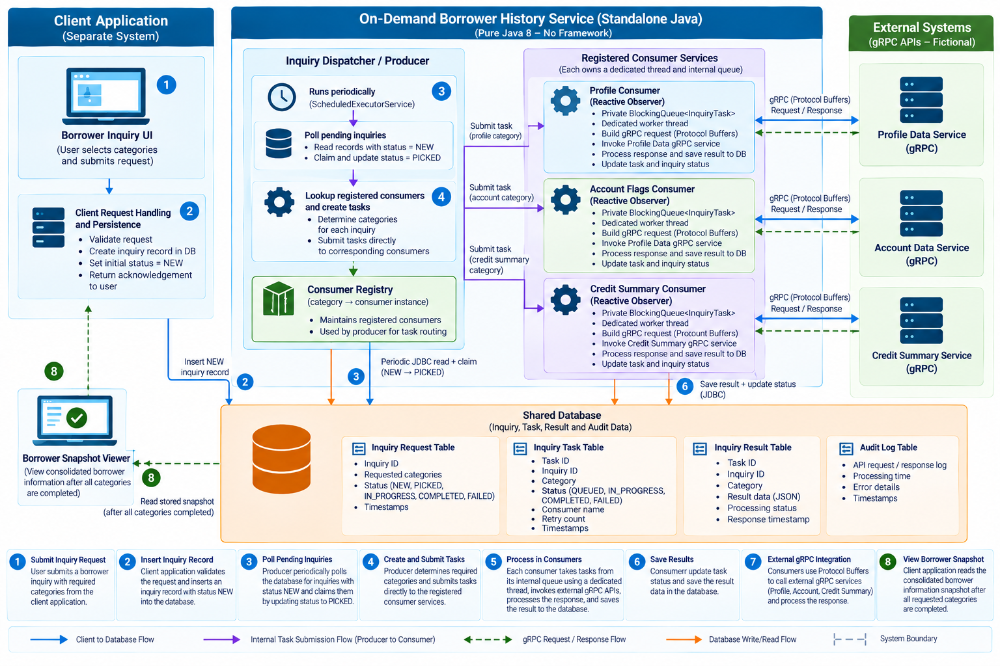
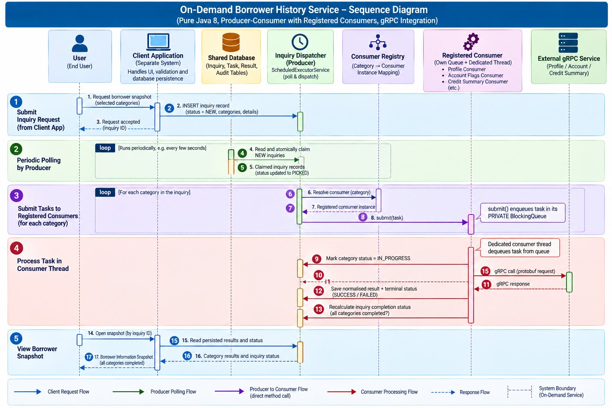

# On-Demand Borrower History Snapshot

**Architecture case study | Java 8 | No application framework | Producer–Consumer | Dedicated worker threads | gRPC**

> **Portfolio disclosure — fictional example:** This case study is an independently reconstructed, fictional example inspired by my professional engineering experience. My actual work involved similar architectural approaches, but the business logic, implementation details, and some design aspects differ. The names, categories, data models, diagrams and code are illustrative and are **not** an exact representation of any employer system. No original employer source code or confidential design documentation is provided.

## 1. Overview

This case study demonstrates a **standalone Java application** that processes borrower information inquiries asynchronously. A separate **Client Application** records requests in a database. The standalone service periodically finds unprocessed requests and dispatches category-specific work to **registered consumer services**, each running on its **own thread and owning its own in-memory queue**. Consumers build gRPC requests, call fictional downstream services, normalise responses and persist category results. The client later reads a consolidated **Borrower Information Snapshot**.

**Critical design distinction:** The producer does **not** publish to a central queue or queue broker. It holds a registry of consumers and submits each task **directly to the appropriate consumer's `submit(...)` method**. The consumer enqueues the task in its **private queue** and processes it on its worker thread.

| Aspect | Mock design |
|---|---|
| Runtime | **Java SE 8**, without Spring, Jakarta EE or another application framework |
| Scheduling | JDK `ScheduledExecutorService` |
| Consumer concurrency | Dedicated Java thread per registered consumer |
| Work handoff | Direct method call to consumer-owned `BlockingQueue` |
| Database access | JDBC with transactions and prepared statements |
| External integration | gRPC Java generated stubs and Protocol Buffers; **no HTTP client** |
| Output | Stored category results and a consolidated borrower snapshot |

*The gRPC Java libraries and JDBC driver are dependencies, not application frameworks.*

## 2. Engineering problem

A borrower snapshot can require multiple independent lookups. Running all inquiries synchronously in a client request would couple user response time to multiple downstream calls and complicate partial failure handling. This mock architecture separates request creation, periodic pickup, category execution and result presentation. It also isolates different inquiry categories behind registered consumer implementations.

### Fictional inquiry categories

- `Bor_profile_flags`: illustrative borrower profile indicators.
- `Bor_acc_flags`: illustrative account-related indicators.
- `Bor_Credit_acc_count_and_total`: illustrative account counts and aggregate totals.

These labels are **invented portfolio names**, not production API identifiers.

## 3. System architecture



*Figure 1. Fictional architecture infographic. The client application is separate from the standalone Java service. The producer directly submits tasks to registered consumer instances; each consumer owns its private queue and worker thread.*

**Boundary clarification:** The client-side API/persistence logic belongs to the **Client Application**, not the standalone service. The database is shared storage accessible to both applications; the producer reads it through JDBC. The boxes labelled `BlockingQueue` are **inside their respective consumer objects**, not independent infrastructure.

## 4. End-to-end processing flow

1. **Create request:** The user selects categories in the Client Application. Its own code validates the input and inserts an inquiry record with status `NEW`.
2. **Poll:** The standalone producer runs periodically using `ScheduledExecutorService` and queries pending inquiries through JDBC.
3. **Claim:** The producer atomically changes a selected request from `NEW` to `PICKED` (or claims it in a transaction) so concurrent polls do not take the same request.
4. **Resolve consumers:** For each requested category, the producer looks up a **previously registered consumer instance** in its in-memory registry.
5. **Direct dispatch:** The producer calls that consumer's `submit(task)`. The consumer puts the task into **its own internal queue**. There is no shared category task queue between the producer and consumers.
6. **Process:** Each consumer's dedicated worker thread dequeues tasks, maps data into a Protocol Buffers request and invokes its corresponding **gRPC** service using a generated stub.
7. **Persist:** The consumer maps the gRPC response into a fictional result record, saves it through JDBC and updates the category task status. The overall inquiry status is updated when all requested categories reach terminal states.
8. **View snapshot:** The Client Application reads the stored category results and displays the Borrower Information Snapshot. It does not call the consumer threads directly.

### Sequence diagram



*Figure 2. Fictional end-to-end processing sequence, from client-side inquiry insertion to scheduled pickup, consumer-owned queue processing, gRPC calls, result persistence and snapshot viewing.*

## 5. Core component responsibilities

| Component | Responsibility | Implementation sketch |
|---|---|---|
| Client Application | Capture inquiry categories; insert `NEW` record; later read snapshot | Separate application; implementation out of scope |
| Inquiry Dispatcher / Producer | Periodic polling, safe claim, category expansion, registered-consumer lookup, direct submission | `ScheduledExecutorService`, JDBC, `Map<InquiryCategory, InquiryConsumer>` |
| Consumer registry | Store mappings between inquiry categories and running consumers | Immutable or concurrent map populated at startup |
| Reactive consumer services | Accept tasks, maintain private queues, process on dedicated worker threads | `BlockingQueue<InquiryTask>`, `Thread`, lifecycle methods |
| Request Mapper | Convert fictional task data to protobuf message | Plain Java mapping code |
| gRPC Provider Adapter | Invoke generated gRPC stub and handle deadlines/statuses | gRPC Java, protobuf |
| Response Normaliser | Convert provider response to stable snapshot fields | Plain Java DTO / mapper |
| Result repository | Persist category result, status, timestamps and audit metadata | JDBC |
| Snapshot reader | Read and combine stored results | Client-side query or shared read-only data access |

“Reactive Observer” here refers to a **consumer receiving and reacting to queued tasks**. It does **not** imply Project Reactor, RxJava or gRPC streaming. The baseline mock uses one worker thread per consumer and can make synchronous gRPC calls from that worker.

## 6. Consumer registration and direct submission

The producer creates or receives a list of consumer instances **at startup**, registers each by category and starts their worker threads. On every poll, it routes a category task to the matching **registered instance**. The examples below use **Java 8 syntax only**: ordinary classes instead of records, `Collections.unmodifiableMap` instead of `Collectors.toUnmodifiableMap`, and Java 8-compatible concurrency APIs.

```java
// Java 8-compatible mock model and consumer registration.
// Each public top-level type would normally be in its own .java file.
import java.util.Collections;
import java.util.EnumMap;
import java.util.List;
import java.util.Map;

enum InquiryCategory {
    BOR_PROFILE_FLAGS,
    BOR_ACC_FLAGS,
    BOR_CREDIT_ACC_COUNT_AND_TOTAL
}

final class InquiryTask {
    private final long inquiryId;
    private final long taskId;
    private final InquiryCategory category;

    InquiryTask(long inquiryId, long taskId, InquiryCategory category) {
        this.inquiryId = inquiryId;
        this.taskId = taskId;
        this.category = category;
    }

    long getInquiryId() { return inquiryId; }
    long getTaskId() { return taskId; }
    InquiryCategory getCategory() { return category; }
}

interface InquiryConsumer extends AutoCloseable {
    InquiryCategory getCategory();
    void start();
    boolean submit(InquiryTask task); // consumer's own private queue
    @Override void close();
}

final class ConsumerRegistry {
    private final Map<InquiryCategory, InquiryConsumer> consumers;

    ConsumerRegistry(List<InquiryConsumer> registeredConsumers) {
        Map<InquiryCategory, InquiryConsumer> map =
            new EnumMap<InquiryCategory, InquiryConsumer>(InquiryCategory.class);
        for (InquiryConsumer consumer : registeredConsumers) {
            if (map.put(consumer.getCategory(), consumer) != null) {
                throw new IllegalArgumentException(
                    "Duplicate consumer for " + consumer.getCategory());
            }
        }
        this.consumers = Collections.unmodifiableMap(map);
    }

    InquiryConsumer get(InquiryCategory category) {
        InquiryConsumer consumer = consumers.get(category);
        if (consumer == null) {
            throw new IllegalArgumentException("No consumer for " + category);
        }
        return consumer;
    }

    void startAll() {
        for (InquiryConsumer consumer : consumers.values()) consumer.start();
    }

    void stopAll() {
        for (InquiryConsumer consumer : consumers.values()) consumer.close();
    }
}
```
A simplified consumer skeleton:

```java
final class CategoryConsumer implements InquiryConsumer {
    private final InquiryCategory category;
    private final java.util.concurrent.BlockingQueue<InquiryTask> queue =
        new java.util.concurrent.ArrayBlockingQueue<>(100);
    private final java.util.concurrent.atomic.AtomicBoolean running =
        new java.util.concurrent.atomic.AtomicBoolean(false);
    private final java.util.function.Consumer<InquiryTask> processor; // Java 8 functional interface
    private Thread worker;

    CategoryConsumer(InquiryCategory category,
                     java.util.function.Consumer<InquiryTask> processor) {
        this.category = category;
        this.processor = processor;
    }

    public InquiryCategory getCategory() { return category; }

    public void start() {
        if (!running.compareAndSet(false, true)) return;
        worker = new Thread(() -> {
            while (running.get() || !queue.isEmpty()) {
                try {
                    InquiryTask task = queue.poll(200,
                        java.util.concurrent.TimeUnit.MILLISECONDS);
                    if (task != null) processor.accept(task);
                } catch (InterruptedException e) {
                    Thread.currentThread().interrupt();
                    break;
                } catch (RuntimeException e) {
                    // Real mock: persist failure and apply a bounded retry policy.
                    e.printStackTrace();
                }
            }
        }, "consumer-" + category);
        worker.start();
    }

    public boolean submit(InquiryTask task) { return queue.offer(task); }

    public void close() {
        running.set(false);
        if (worker != null) worker.interrupt();
    }
}
```

**Java 8 compatibility:** `BlockingQueue`, `ArrayBlockingQueue`, `AtomicBoolean`, lambda expressions, `ScheduledExecutorService`, `AutoCloseable` and `java.util.function.Consumer` are available in Java 8. No records, `var`, switch expressions, or Java 9+ collection factories are used.

**Important:** `submit()` returns `false` when the private queue is full. The producer must then **persist the task as awaiting dispatch** and retry later; it must not silently drop it. The skeleton above is illustrative, not a complete restart-safe implementation.

### Producer polling and dispatch (pseudocode)

```java
// Java 8: called periodically by ScheduledExecutorService.
void pollAndDispatch() {
    List<InquiryTask> tasks = repository.claimPendingRequestsAndCreateTasks();
    for (InquiryTask task : tasks) {
        InquiryConsumer consumer = registry.get(task.getCategory());
        if (consumer.submit(task)) {
            repository.markQueued(task);  // see durability note below
        } else {
            repository.markAwaitingDispatch(task);
        }
    }
}
```

The claim/create operation should be transactional. Because the consumer queues are **in memory**, there is a crash window between database updates and queue submission. A more reliable mock uses a persisted task/outbox record, idempotent task identifiers, a recoverable `AWAITING_DISPATCH`/`QUEUED` state and startup reconciliation. `markQueued` is therefore an **illustrative status transition**, not a guarantee of durable delivery.

## 7. gRPC integration (not HTTP clients)

Each consumer builds a Protocol Buffers request, invokes a generated Java gRPC stub and translates the response into a stored snapshot result.

```proto
syntax = "proto3";
package demo.borrower;
option java_multiple_files = true;
option java_package = "demo.borrower.grpc";

service ProfileDataService {
  rpc GetProfileFlags (ProfileFlagsRequest) returns (ProfileFlagsReply);
}

message ProfileFlagsRequest { string borrower_ref = 1; }
message ProfileFlagsReply {
  bool has_profile_flag = 1;
  string summary = 2;
}
```

```java
// Generated protobuf / gRPC types assumed.
final class ProfileGrpcAdapter {
    private final ProfileDataServiceGrpc.ProfileDataServiceBlockingStub stub;

    ProfileGrpcAdapter(io.grpc.Channel channel) {
        this.stub = ProfileDataServiceGrpc.newBlockingStub(channel);
    }

    ProfileFlagsReply fetch(String fictionalBorrowerRef) {
        ProfileFlagsRequest request = ProfileFlagsRequest.newBuilder()
            .setBorrowerRef(fictionalBorrowerRef)
            .build();
        return stub.withDeadlineAfter(3, java.util.concurrent.TimeUnit.SECONDS)
                   .getProfileFlags(request);
    }
}
```

The example uses a **blocking gRPC stub inside a dedicated consumer thread**. A later version could use asynchronous gRPC callbacks, but that would require explicit callback lifecycle, queueing and persistence design. Never include actual borrower identifiers or sensitive responses in public logs or mock data.

## 8. Illustrative persistence model

| Table | Example fields | Purpose |
|---|---|---|
| `inquiry_request` | `inquiry_id`, `requested_categories`, `status`, `created_at`, `picked_at` | Tracks overall request |
| `inquiry_task` | `task_id`, `inquiry_id`, `category`, `status`, `attempt_count`, `updated_at` | Tracks per-category execution and recovery |
| `inquiry_result` | `task_id`, `result_json`, `processed_at` | Stores fictional normalised results |
| `inquiry_audit` | `task_id`, `event_type`, `occurred_at`, `error_code` | Tracks processing events without secrets |

Suggested statuses: inquiry `NEW → PICKED → IN_PROGRESS → COMPLETED` or `PARTIAL/FAILED`; task `AWAITING_DISPATCH → QUEUED → IN_PROGRESS → COMPLETED/FAILED`. These are **proposed mock states**, not verified original database values.

Example fictional snapshot:

```json
{
  "inquiryId": "DEMO-1001",
  "status": "COMPLETED",
  "snapshot": {
    "Bor_profile_flags": {"hasProfileFlag": false},
    "Bor_acc_flags": {"hasAccountFlag": true},
    "Bor_Credit_acc_count_and_total": {
      "accountCount": 2,
      "illustrativeAggregate": 1200.00
    }
  }
}
```

## 9. Concurrency, reliability and safety

- **No shared dispatch queue:** producer-to-consumer calls are direct; each consumer owns its queue and worker thread.
- **Atomic pickup:** claim `NEW` inquiries using a transaction or conditional update so overlapping polls cannot process the same request unintentionally.
- **Backpressure:** use bounded queues and a persisted `AWAITING_DISPATCH` state when submission fails.
- **Restart recovery:** rebuild work from persisted task states; never rely solely on in-memory queues.
- **Idempotency:** use a stable task ID and uniqueness constraints to prevent duplicate stored results after retries.
- **gRPC deadlines:** set explicit timeouts and distinguish transient `UNAVAILABLE`/`DEADLINE_EXCEEDED` errors from permanent failures.
- **Retry discipline:** bounded retries with backoff; retry only when safe for the downstream operation.
- **Completion semantics:** mark the inquiry `COMPLETED` only when all requested category tasks have completed successfully; otherwise record `PARTIAL` or `FAILED` according to the mock policy.
- **Privacy:** use synthetic data, non-sensitive event logs and no real account or customer details.
- **Thread shutdown:** stop polling, reject new submissions, drain or persist outstanding tasks, and close gRPC channels cleanly.

## 10. Proposed plain-Java mock project structure

```text
borrower-snapshot-demo/
├── README.md
├── pom.xml                     # Build only; no application framework
├── src/main/proto/
│   └── profile_data.proto
├── src/main/java/demo/borrower/
│   ├── Main.java               # Bootstrap + consumer registration
│   ├── model/
│   │   ├── InquiryCategory.java
│   │   └── InquiryTask.java
│   ├── dispatcher/
│   │   └── InquiryDispatcher.java
│   ├── consumer/
│   │   ├── InquiryConsumer.java
│   │   ├── ConsumerRegistry.java
│   │   └── CategoryConsumer.java
│   ├── grpc/
│   │   ├── ProfileGrpcAdapter.java
│   │   ├── AccountGrpcAdapter.java
│   │   └── CreditSummaryGrpcAdapter.java
│   ├── mapping/
│   │   └── ResponseNormaliser.java
│   └── persistence/
│       ├── InquiryRepository.java
│       └── JdbcInquiryRepository.java
└── src/test/java/demo/borrower/
    └── ...
```

`pom.xml` should configure source and target compatibility to `1.8` and use **Java 8-compatible versions** of gRPC, protobuf, a JDBC driver and testing dependencies. Maven is only a build tool; it does not imply Spring or another application framework. A fully runnable mock should provide fictional gRPC servers, schema creation and test fixtures.

### Java 8 build configuration

For a Maven build, the Java language level can be specified as:

```xml
<properties>
    <maven.compiler.source>1.8</maven.compiler.source>
    <maven.compiler.target>1.8</maven.compiler.target>
</properties>
```

Select and verify dependency versions that still support Java 8. The gRPC/protobuf snippets are illustrative and require generated classes from the fictional `.proto` contract.

## 11. Verification plan for the mock

| Test | Expected result |
|---|---|
| Create an inquiry with three categories | One request stored; three category tasks eventually dispatched |
| Poll when no `NEW` inquiries exist | No duplicate tasks or calls |
| Register three consumers | Producer routes each task to the matching consumer's **internal** queue |
| Two categories finish at different times | Independent task states; snapshot remains in progress until completion policy is met |
| Queue reaches capacity | Task remains recoverable and is retried; no silent loss |
| gRPC deadline expires | Error recorded, bounded retry or terminal failure |
| Process stops with queued work | Restart reconciliation re-enqueues unfinished persisted tasks |
| Two producer polls race | Atomic claim prevents duplicate pickup |
| Consumer completes same task twice | Idempotent persistence prevents duplicate result records |

## 12. Engineering design rationale and scope

The principal design choice is a **registered producer–consumer architecture**: the producer handles database polling and dispatch decisions, while category-specific consumer objects own the execution threads, queues, gRPC mapping, invocation and persistence. This separation supports category isolation and makes new fictional inquiry categories straightforward to add by registering another consumer.

This portfolio case study demonstrates architectural reasoning around **Java 8 concurrency, periodic database polling, consumer registration, queue ownership, gRPC integration and result persistence**. It is **not** a claim that every suggested safeguard, status transition or example class existed in the original project. Performance figures and production outcomes are intentionally omitted because no independently verified measurements have been supplied.

---

[← Back to engineering portfolio](../../README.md) · [Professional engineering profile](../../01-professional-profile/engineering-profile.md)

